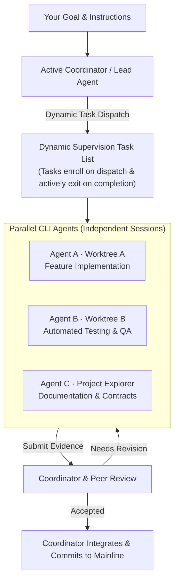

**English** | [简体中文](README.zh-CN.md)

# Warpai

### The terminal built around agents.

Make an Agent session the unit of work. Collaborate in a shared project, or select
a Coordinator to lead parallel development across isolated Git worktrees.
Warpai combines that workflow with a full-featured native terminal for macOS,
Windows, and Linux. Keep the same Agent, file, and review workflow on remote
Linux, macOS, and Windows machines.

**One project · Many agents · One coordinated workflow**

[Download 1.7.8.2](#get-warpai) · [How teams work](#agents-as-the-unit-of-work) ·
[Supported agents](specs/agent-communication/COVERAGE.md) ·
[Documentation](https://othinusg.github.io/warpai/) ·
[Report an issue](https://github.com/OthinusG/warpai/issues)

*Warpai 3-column workspace with vertical tabs and default Claude Warm Light theme: Left Agent collaboration panel with dynamic task supervision, center GPU terminal with command blocks, and right Project Explorer with live editor.*

## A workflow designed for the AI era

An Agent is more than a chat window beside your code. It can take ownership of a
piece of work, report progress, ask another Agent for help, and return a result
for review. Warpai gives those Agent sessions a shared project context and a
place to coordinate.

### Two specialized collaboration modes

Warpai provides two first-class modes tailored for different problem domains:

- **Git Worktree Coding Mode**: Built for disciplined software engineering. Each feature or subtask is assigned to an isolated physical Git worktree checkout. Branch checkouts and file writes remain completely decoupled, eliminating Git checkout collisions and dirty working tree contention. An active Agent is selected as **Coordinator** to decompose requirements, assign tasks, orchestrate automated peer reviews (`accepted` vs. `needs_changes`), and integrate verified diffs into the mainline branch.
- **Omnidirectional Project Mode**: Built for cross-domain and non-coding tasks (scientific research, literature reviews, quantitative finance, report writing, and patent compliance). Project mode breaks rigid single-coordinator hierarchies into an egalitarian mesh network. Any agent can directly message any peer, initiate structured two-way Q&A, publish shared context contracts, and pull work items from a shared task pool. No Git repository is required.

### Dynamic task supervision (v1.7.0)

Warpai v1.7.0 introduces **Dynamic Task Supervision**:

1. **On-the-fly task dispatching**: Any supervising Agent or Coordinator can dynamically publish tasks to multiple agents at any time, adapting flexibly as execution unfolds rather than relying on static, upfront batch plans.
2. **Persistent task queuing & sequential execution**: Dispatched tasks enter durable recipient queues (`queued`). Workers execute one task at a time (`running`), preventing dirty working tree contention, and pop queued items sequentially via `warp_task_start` upon submission.
3. **Dynamic supervision list enrollment**: Newly dispatched tasks immediately join the primary Agent's live **Supervision Task List**. The supervising agent actively tracks task lifecycle states (`assigned`, `in_progress`, `submitted_for_review`).
4. **Active task retirement**: Once an assigned agent completes its deliverable and submits accepted evidence or code diffs, the task automatically exits the supervision list.
5. **Guarded inbox delivery**: Busy agents receive incoming tasks and messages in arrival order without unexpected process interruptions. Timeouts never prematurely restart in-flight work.
6. **Subtask autonomy and ready state**: An Agent's internal subtask states are not monitored, because the Agent itself is in a ready state that can receive tasks. The external coordination fabric tracks cross-Agent task lifecycles; micro-subtasks an Agent decomposes internally do not enter the supervision list.

## One workspace for the whole loop

Warpai brings Agent management and project work into one unified application, reducing trips between a terminal, a separate Agent dashboard, a file browser, and a code review tool.

- **Left Agent collaboration panel**:
  - Manage and inspect active CLI Agent sessions with fine-grained lifecycle states (`idle`, `busy`, `waiting_for_input`, `waiting_for_dependents`, `waiting_for_message`).
  - Follow the **Dynamic Supervision Task List** and inspect evidence submitted by peers.
  - Switch smoothly between **Project Mode** and **Worktree Mode**; designate or switch the Coordinator from any active checkout.
  - Monitor token quotas, model providers, and available balances in the scrollable **Data usage** footer.
- **Center GPU-accelerated terminal**:
  - High-performance GPU rendering powered by Rust `wgpu` and `winit`.
  - Discrete command blocks with exit codes, execution duration, and isolated copy/share tools.
  - Vertical tab management, split panes, intelligent autocompletion, fuzzy command palette, and configurable keep-awake controls.
- **Right Project Explorer & built-in editor**:
  - Browse, create, rename, and delete project files locally or across SSH remote hosts.
  - Built-in text and code editor with syntax highlighting, line numbers, and Vim keybindings.
  - Live Markdown preview with rendered math formulas, diagrams, and media.
  - Visual side-by-side Git diff code review for both local and remote checkouts.

## Use the Agents you already choose

Warpai supports **20+ named CLI Agent types**, including Codex, Claude Code, Gemini CLI, Cursor, Qoder, Goose, Hermes, OpenCode, Antigravity CLI, Trae, and more. Agents retain their own vendor accounts, environment variables, and authentication; Warpai provides the local coordination fabric connecting them.

Enable **Settings > Features > Agent communication** to select participating agents. Communication is powered by the bundled `warpai-local-com` MCP server, exposing **38+ native tools** for task assignment, status reporting, peer review, context sharing, and non-blocking file reservations.

### Multi-provider quota monitoring

The collaboration panel's **Data usage** footer displays connected provider accounts. Configure accounts and thresholds in **Settings > Features > Data usage**. The footer independently scrolls up to four accounts, keeping provider badges, quota progress bars, and token balances visible while you coordinate active tasks.

## Remote work is part of the same workflow

**The exact same working loop is available locally and remotely:** Agent management, terminal execution, file exploration, in-app editing, and code reviews. Connect to any remote Linux, macOS, or Windows host via SSH and navigate to your project directory; the entire workspace automatically follows the focused terminal's remote directory.

The standalone **Warpai Companion** powers remote projects:
- **Private bundled Git**: Companion includes its own private Git runtime. The remote server does not require Git, Python, Node.js, tmux, or socat to be installed.
- **On-demand execution**: Companion starts automatically upon connection and terminates after 60 idle seconds, leaving zero residual background memory footprint.
- **Safety & resilience**: Unsaved remote file edits remain preserved across unexpected network disconnects.

*SSH remote workspace with live remote agent coordination and SFTP file management. See [screenshot provenance](docs/images/README.md).*

- **Detailed installation and setup guides**:
  - [OpenSSH Server Installation and Setup Guide (Linux / macOS / Windows)](docs/SSH-INSTALLATION.md)
  - [Windows WSL Installation and Setup Guide](docs/WSL-INSTALLATION.md)
  - [Remote Components and Protocol Reference](docs/REMOTE-INSTALLATION.md)

## Beyond software development

Warpai is useful wherever complex work can be decomposed into tasks and handled with CLI Agents, scripts, and project files:

| Domain | Example Agent Team |
| --- | --- |
| **Research & data science** | A lead Agent designs the literature review; one Agent extracts scientific methodologies, another analyzes datasets with Python/R, and a reviewer verifies calculations and citation DOI links. Results are consolidated into a publication draft. |
| **Writing & knowledge work** | One Agent structures the document outline, another retrieves supporting evidence, and a third refines tone and consistency. The lead harmonizes disagreements and prepares the final deliverable. |
| **Quantitative finance & ops** | Delegate market data scraping, statistical modeling, algorithmic backtesting, and automated risk verification. Results are consolidated into an executive decision memo. |
| **Software development** | Use Worktree mode to distribute feature implementation, unit testing, and documentation across isolated branch checkouts. The Coordinator oversees peer review and integrates accepted changes. |

## Where Warpai fits

| System Archetype | Representative Tools | Warpai's Workflow & Architectural Focus |
| --- | --- | --- |
| **Traditional Terminals** | [Ghostty](https://ghostty.org/), [Kitty](https://sw.kovidgoyal.net/kitty/), [Windows Terminal](https://github.com/microsoft/terminal), [Alacritty](https://alacritty.org/) | Retains native GPU acceleration and minimal latency while adding in-memory VT100 screen tracking and guarded PTY delivery to eliminate dropped keystrokes during agent redrawing. |
| **Agent-Enabled Editors** | [Zed](https://zed.dev/docs/ai/overview), [Cursor](https://www.cursor.com/), [Windsurf](https://codeium.com/windsurf), [Trae](https://www.trae.ai/) | Replaces single-workspace edit collisions with physical Git Worktree isolation; natively manages 20+ independent CLI agents with zero vendor cloud lock-in. |
| **Full IDEs** | [VS Code](https://code.visualstudio.com/docs/agents/overview), [JetBrains](https://www.jetbrains.com/) (IntelliJ IDEA), Eclipse | Fast startup (<100ms) and low memory footprint; serves as an agile multi-agent hub that complements heavy IDEs without terminal lag or runaway CPU consumption. |
| **Autonomous ADEs & Sandboxes** | [Orca](https://github.com/orca-ai), [Conductor](https://www.conductor.build/), [OpenDevin](https://github.com/All-Hands-AI/OpenHands), Devin | 100% local-first without multi-gigabyte Docker container overhead or costly cloud subscriptions; source code and secrets never leave your local hardware or private SSH nodes. |
| **Multi-Agent Frameworks & Multiplexers** | [Herdr](https://github.com/herdr), [AutoGen](https://microsoft.github.io/autogen/), [CrewAI](https://www.crewai.com/), tmux scripts | Blends a modern GUI terminal workbench (tabs, splits, diffs, editor) with an industrial-grade local SQLite MCP coordination bus (38+ native tools, task pools, peer reviews). |
| **Desktop AI Chat Apps** | [ChatGPT Desktop](https://chatgpt.com/), [Claude Desktop](https://claude.ai/download), TypingMind | Eliminates repetitive copy-paste context switching; agents run directly inside genuine terminal sessions to read/write code, run tests, and gate high-risk actions. |
| **Upstream Warp** | [Warp](https://www.warp.dev/terminal) | Deeply strips 51+ proprietary cloud files, Sentry telemetry, and mandatory login paywalls (100% AGPL-3.0 open source), while adding native 20+ CLI agent sensing and dual collaboration modes. |

## Technology

Warpai is a native desktop application written in **Rust**, utilizing the `warpui` UI framework, **wgpu** GPU rendering, and **winit** window management. Agent coordination states are managed locally via SQLite. Native desktop installers are available for **macOS, Windows, and Linux**; Linux packages target x86_64 and ARM64, while Companion also supports remote Linux hosts.

## Get Warpai

**[Warpai 1.7.8.2](https://github.com/OthinusG/warpai/releases/tag/v1.7.8.2)** fixes saved Agent MCP installation records after the 1.7.8.1 server-name change. Local, SSH, and WSL records now migrate their install, lookup, and cleanup commands to `warpai-local-com`, `warpai-ssh-com`, and `warpai-wsl-com`, respectively. Inactive cleanup records can be selected again in Settings; existing user MCP entries and activation choices are preserved. Companion remains **5.5.0**.

Choose English, 简体中文, or 繁體中文 in **Settings > Appearance > Language** and restart to apply. Desktop settings and application data are stored locally in `~/.config/warpai`.

### Desktop downloads (v1.7.8.2)

| Platform | Download | Installation |
| --- | --- | --- |
| **macOS 11.0+ (Big Sur+) · Apple Silicon** | [DMG Installer](https://github.com/OthinusG/warpai/releases/download/v1.7.8.2/Warpai-1.7.8.2-macos-arm64.dmg) | Drag **Warpai.app** into `/Applications`. |
| **Windows 10/11 · x64** | [EXE Installer](https://github.com/OthinusG/warpai/releases/download/v1.7.8.2/WarpaiSetup-1.7.8.2-windows-x64.exe) | Run the setup wizard. |
| **Linux · x86_64** | [AppImage](https://github.com/OthinusG/warpai/releases/download/v1.7.8.2/Warpai-1.7.8.2-linux-x64.AppImage) · [DEB](https://github.com/OthinusG/warpai/releases/download/v1.7.8.2/Warpai-1.7.8.2-linux-x64.deb) · [RPM](https://github.com/OthinusG/warpai/releases/download/v1.7.8.2/Warpai-1.7.8.2-linux-x64.rpm) · [Arch](https://github.com/OthinusG/warpai/releases/download/v1.7.8.2/Warpai-1.7.8.2-linux-x64.pkg.tar.zst) | AppImage: `chmod +x Warpai-1.7.8.2-linux-x64.AppImage && ./Warpai-1.7.8.2-linux-x64.AppImage` DEB: `sudo apt install ./Warpai-1.7.8.2-linux-x64.deb` RPM: `sudo dnf install ./Warpai-1.7.8.2-linux-x64.rpm` Arch: `sudo pacman -U ./Warpai-1.7.8.2-linux-x64.pkg.tar.zst` |
| **Linux · ARM64** | [AppImage](https://github.com/OthinusG/warpai/releases/download/v1.7.8.2/Warpai-1.7.8.2-linux-arm64.AppImage) · [DEB](https://github.com/OthinusG/warpai/releases/download/v1.7.8.2/Warpai-1.7.8.2-linux-arm64.deb) · [RPM](https://github.com/OthinusG/warpai/releases/download/v1.7.8.2/Warpai-1.7.8.2-linux-arm64.rpm) · [Arch](https://github.com/OthinusG/warpai/releases/download/v1.7.8.2/Warpai-1.7.8.2-linux-arm64.pkg.tar.zst) | AppImage: `chmod +x Warpai-1.7.8.2-linux-arm64.AppImage && ./Warpai-1.7.8.2-linux-arm64.AppImage` DEB: `sudo apt install ./Warpai-1.7.8.2-linux-arm64.deb` RPM: `sudo dnf install ./Warpai-1.7.8.2-linux-arm64.rpm` Arch: `sudo pacman -U ./Warpai-1.7.8.2-linux-arm64.pkg.tar.zst` |

Linux desktop packages target x86_64 and ARM64 with glibc 2.31 or later. See the [Linux installation guide](https://othinusg.github.io/warpai/docs/install.html) for distribution-specific details.

*macOS Note: Builds are ad-hoc signed. If blocked on first run, click **Open Anyway** under System Settings > Privacy & Security, or run `xattr -d com.apple.quarantine /Applications/Warpai.app`.*

### Remote companion (v5.5.0)

Warpai Companion provides the remote server workspace for Linux, macOS, and Windows machines over SSH:

| Remote Host | Package | Installation |
| --- | --- | --- |
| **Linux x64** (Ubuntu 20.04+, Debian, RHEL) | [Standalone Installer](https://github.com/OthinusG/warpai/releases/download/v1.7.8.2/WarpaiCompanion-5.5.0-linux-x64.run) | `chmod +x WarpaiCompanion-*.run && ./WarpaiCompanion-*.run` |
| **macOS Apple Silicon** | [DMG Image](https://github.com/OthinusG/warpai/releases/download/v1.7.8.2/WarpaiCompanion-5.5.0-macos-arm64.dmg) | Copy `warpai-companion` to `~/.config/warpai/bin/` |
| **Windows x64** | [Setup EXE](https://github.com/OthinusG/warpai/releases/download/v1.7.8.2/WarpaiCompanion-5.5.0-windows-x64-setup.exe) | Run installer on remote host. |

## Local by design

Warpai requires no cloud account, registration, login, or subscription. The product contains zero bundled cloud AI models, telemetry trackers, or background data harvesting. Your selected CLI Agents retain their own authentication, tokens, and billing.

## Develop and contribute

Read the [development guide](docs/DEVELOPMENT.md), [agent specifications](AGENTS.md), and [MCP protocol definitions](docs/FEATURE-DEPENDENCIES.md). Builds and releases use committed repository sources.

Terminal core guardrails for contributors

Preserve these rendering, input, and model paths. Replacing them with wholesale stubs is not an acceptable compile fix; verify terminal behavior as well as builds:

- `app/src/terminal/view.rs`
- `app/src/terminal/input.rs`
- `app/src/terminal/block_list_element.rs`
- `app/src/terminal/view/`
- `app/src/terminal/input/`
- `app/src/terminal/local_tty/terminal_manager.rs`
- `app/src/terminal/alt_screen/alt_screen_element.rs`
- `app/src/terminal/model/`

## Acknowledgements and license

Warpai is independently maintained and derives from [terzigolu/warp-lite](https://github.com/terzigolu/warp-lite) and [Warp](https://github.com/warpdotdev/warp). It is not affiliated with or endorsed by the upstream Warp team. Original copyright and attribution are retained.

Source code is licensed under [AGPL-3.0-only](LICENSE-AGPL); original `warpui` and `warpui_core` crates retain their [MIT license](LICENSE-MIT). See [fork notice](FORK_NOTICE.md).
