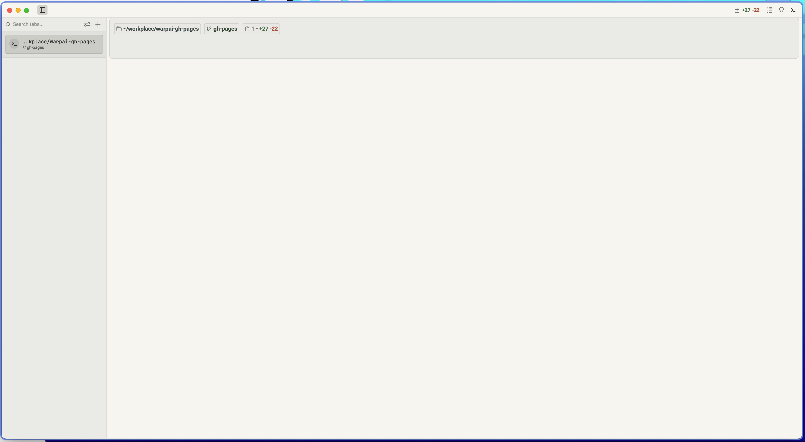
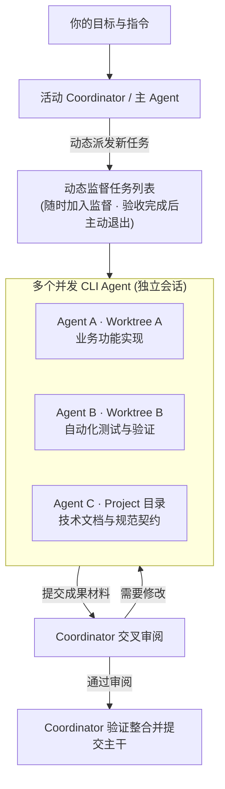

[English](README.md) | **简体中文**

# Warpai

### 为 Agent 协作而生的终端工作空间。

把一次 Agent 会话当作工作的基本单元。在项目中共享协作，或选择一位 Coordinator，
让多个 Agent 在独立 Git worktree 中并行开发。Warpai 以全功能原生终端为基础，桌面原生支持 macOS 和 Windows，
在远程 Linux、macOS 和 Windows 上也能保持同样的 Agent、文件和审阅工作流。

**一个项目 · 多个 Agent · 一条协作工作流**

[下载 1.7.0](#get-warpai) · [Agent 如何协作](#agents-as-the-unit-of-work) ·
[支持的 Agent](docs/AGENTS.zh-CN.md) ·
[官方文档](https://othinusg.github.io/warpai/zh/) ·
[反馈问题](https://github.com/OthinusG/warpai/issues)

*Warpai 三栏全景工作空间（默认 Claude Warm Light 暖光主题与垂直标签页）：左侧 Agent 协同面板与动态监督任务列表、中间 GPU 原生终端与独立执行块、右侧 Project Explorer 与内置源码编辑器。*

## 为 AI 时代重组工作流

Agent 不只是代码旁边的聊天窗口。它可以接手一项具体工作、汇报进展、向其他 Agent 求助，
并把结果交给同伴审阅。Warpai 让多个 Agent 会话共享同一个项目上下文，也给它们一个协同工作的地方。

### 两种专属协作模式

Warpai 针对不同业务形态提供两种第一公民协作模式：

- **Git Worktree 并发编码模式**：专为高纪律软件工程打造。每个功能分支或子任务对应一个物理隔离的独立 Git 工作树目录。文件变更与编译缓存完全解耦，彻底避免分支切换冲突与未提交改动互相污染。支持从任意活跃会话指定一位 **Coordinator（协调者）**，负责拆解需求、派发任务、组织自动化对等代码审阅（Peer Review diffs），并将验收通过的代码安全合并至主干。
- **Project 全向协同模式**：专为跨领域与非编码场景打造（科研论文、文献综述、量化金融、报告撰写与专利法务）。打破传统单一指挥链与主从层级，所有 Agent 在扁平网状拓扑中对等协作。任意 Agent 均可自由发起定向问答、发布共享上下文契约、在公共任务池中分发与认领任务。无需创建 Git 仓库，可在任意普通文件夹中即开即用。

### 动态任务监督列表（v1.7.0 重磅升级）

在 1.7.0 版本中，Warpai 全面重构并升级了任务协同逻辑：

1. **随时动态发布任务**：主 Agent 或 Coordinator 可以随时向多个 Agent 动态派发任务，根据项目推进过程灵活扩充，无需在启动前僵化预设全部任务。
2. **任务持久化排队与串行执行**：派发任务持久化进入接收方队列（`state: "queued"`），执行方单任务独占串行推进（`running`），杜绝工作区并发写入冲突，并在提交前序任务后通过 `warp_task_start` 依次出队。
3. **加入动态监督列表**：新发布的任务会自动加入主 Agent 的**监督任务列表（Supervision Task List）**，主 Agent 持续跟踪任务的生命周期流转（`assigned`、`in_progress`、`submitted_for_review`）。
4. **完成主动退出列表**：被分派的 Agent 在执行完毕并提交测试材料或代码改动后，经过验证或审阅通过，任务主动从监督列表中移出归档。
5. **守卫收件箱队列**：处于忙碌状态的 Agent 会按到达顺序排队处理外部任务和消息，防止进程意外被抢占打断；超时不会无故自动重跑已终止的工作。

## 一个工作空间跑通全协作闭环

Warpai 将 Agent 管理与日常项目工作深度融合在单一桌面应用中，避免在终端、外部 Web 看板、文件管理器与代码审阅工具之间频繁来回跳转：

- **左侧 Agent 协同面板**：
  - 实时监控活跃 CLI Agent 会话细粒度状态（`idle` 空闲、`busy` 忙碌、`waiting_for_input` 等待输入、`waiting_for_dependents` 等待前置依赖、`waiting_for_message` 等待消息）。
  - 直观追踪**动态监督任务列表**、任务分配流转及同伴提交的验收证据。
  - 一键平滑切换 **Project 模式** 与 **Worktree 模式**；支持从任意活动目录切换 Coordinator。
  - 面板底部提供可独立滚动的 **Data usage** 用量栏，实时显示各大模型服务商的配额进度条与账户余额。
- **中间 GPU 加速原生终端**：
  - 基于 Rust `wgpu` 与 `winit` 构建的高性能硬件加速终端渲染管线。
  - 独立命令块（Blocks）设计：独立退出状态码、耗时统计与专属复制/分享。
  - 垂直标签栏、自由分屏、智能命令补全、模糊命令面板以及防休眠控制。
- **右侧 Project Explorer 与内置轻量编辑器**：
  - 轻松浏览、创建、重命名与删除本地及远程 SSH 文件。
  - 内置源码与文本编辑器，支持语法高亮、行号显示以及 Vim 快捷键操作。
  - 实时 Markdown 双栏渲染，完美支持数学公式、架构图表与媒体展示。
  - 本地与远程 Git 改动可视化双栏差异对比（Code Review）。

## 使用你已经选择的 Agent 生态

Warpai 原生支持 **20+ 种主流 CLI Agent**，涵盖 Codex、Claude Code、Gemini CLI、Cursor、Qoder、Goose、Hermes、OpenCode、Antigravity CLI、Trae 等。各 Agent 继续沿用各自的服务商、本地环境变量与鉴权体系；Warpai 充当底层轻量协同中枢。

在 **Settings > Features > Agent communication** 中开启协同支持。协同体系基于内置的 `warp-lite-communication` 原生 MCP 服务，提供 **38+ 项标准工具接口**，覆盖任务分派、状态汇报、交叉审阅、上下文共享以及非阻塞文件锁（File Reservations）。

### 多服务商用量实时监控

协作面板底部的 **Data usage** 栏支持同时添加多个服务商账户。在 **Settings > Features > Data usage** 中配置展示项。用量区域支持独立滚动，常驻显示服务商图标、账户标识、配额进度条与可用代币余额，切换任务与查看进度时一目了然。

## 远程也能完成同样的工作流

**本地与远端保持完全一致的工作体验：**Agent 管理与协同、完整终端、文件管理、应用内编辑与文档预览均无缝延伸至远程环境。在终端中通过 SSH 连接任意 Linux、macOS 或 Windows 机器并进入项目目录，整个 Warpai 工作空间便会自动跟随焦点终端的远程 `cd` 进行漫游。

独立的 **Warpai Companion** 为远端主机赋能：
- **自带私有 Git 运行时**：远程主机**无需预装** Git、Python、Node.js、tmux 或 socat 即可直接使用完整的文件与 Agent 协作功能。
- **按需启动与零常驻开销**：连接时自动唤醒，空闲 60 秒后自动退出，绝不侵占服务器宝贵内存。
- **断网防丢保护**：网络发生波动或断开时，未保存的远程文件修改将妥善保留在本地防丢缓存中。

*SSH 远程工作空间原生运行截图：远程 Agent 接管与 SFTP 文件树联动。详见[截图来源说明](docs/images/README.zh-CN.md)。*

## 不止软件开发

只要工作能拆解为任务，并能借助 CLI Agent、自动化脚本或项目文件处理，都可以使用 Warpai 组织专属 Agent 团队：

| 工作场景 | Agent 团队分工示例 |
| --- | --- |
| **科研文献与数据分析** | 主 Agent 规划综述结构；一位 Agent 提取论文研究方法，另一位使用 Python/R 脚本清洗分析数据集，第三位核对公式推导与 DOI 引文链路。主 Agent 统筹汇总为学术初稿。 |
| **写作与知识工程** | 一位 Agent 梳理报告大纲框架，一位搜集事实支撑材料，另一位负责文字润色与术语统一。主 Agent 处理分歧并完成定稿。 |
| **量化金融与商业分析** | 委派不同 Agent 分别执行市场数据抓取、风险模型回测、行业研报分析与合规核验，最后汇聚为高管决策简报。 |
| **软件架构与开发** | 采用 Worktree 模式，将功能实现、单元测试与架构文档分配到独立分支目录中并行推进。由 Coordinator 统一把关交叉审阅并集成提交。 |

## Warpai 的定位

| 对比体系分类 | 代表性工具 | Warpai 的工作流与架构优势 |
| --- | --- | --- |
| **传统终端** | [Ghostty](https://ghostty.org/)、[Kitty](https://sw.kovidgoyal.net/kitty/)、[Windows Terminal](https://github.com/microsoft/terminal)、[Alacritty](https://alacritty.org/) | 保持原生 GPU 极速渲染与超低延迟的同时，内置内存级 VT100 屏幕状态观察器与守护式 PTY 交付，避免 Agent 输出吞键，提供多 Agent 统一状态面板。 |
| **Agent 文本编辑器** | [Zed](https://zed.dev/docs/ai/overview)、[Cursor](https://www.cursor.com/)、[Windsurf](https://codeium.com/windsurf)、[Trae](https://www.trae.ai/) | 打破单工作区文件写踩踏；以物理 Git Worktree 隔离多 Agent 并行开发，原生纳管 20+ 款独立 CLI Agent，零厂商云端绑定。 |
| **传统综合 IDE** | [VS Code](https://code.visualstudio.com/docs/agents/overview)、[JetBrains](https://www.jetbrains.com/)（IntelliJ IDEA）、Eclipse | 极速启动与超轻量内存开销；专注作为多 Agent 敏捷协同中枢，与传统重型 IDE 优势互补，告别 IDE 内置终端发热卡顿。 |
| **自主 ADE 与沙盒** | [Orca](https://github.com/orca-ai)、[Conductor](https://www.conductor.build/)、[OpenDevin](https://github.com/All-Hands-AI/OpenHands)、Devin | 100% 本地优先，免去数十 GB Docker 镜像或高昂云端账单；代码与凭据不出本地设备或自有 SSH 服务器，无数据泄露风险。 |
| **多 Agent 框架与平铺工具** | [Herdr](https://github.com/herdr)、[AutoGen](https://microsoft.github.io/autogen/)、[CrewAI](https://www.crewai.com/)、tmux 脚本 | 将现代化 GUI 终端工作台（多标签、分屏、Diff、编辑器）与工业级本地 MCP 协同总线（38+ 原生工具、异步任务池、对等互审）深度融合。 |
| **桌面端 AI 对话应用** | [ChatGPT Desktop](https://chatgpt.com/)、[Claude Desktop](https://claude.ai/download)、TypingMind | 消除跨应用复制粘贴内耗；直接在真实系统终端与项目目录中自主执行命令、读写文件、跑通测试并在高危节点精准请求授权。 |
| **原版 Warp** | [Warp](https://www.warp.dev/terminal) | 彻底剔除 51+ 个云端 AI 文件、Sentry 遥测与强制邮箱登录墙（AGPL-3.0 完全开源），新增 20+ 款独立 CLI 自动挂载与双重协同架构。 |

## 技术栈

Warpai 是一款使用 **Rust** 编写的高性能原生桌面应用，采用自有 `warpui` UI 框架、**wgpu** GPU 硬件渲染管线和 **winit** 跨平台窗口层。协同状态全部保存在本地 SQLite 数据库中。当前发布的桌面安装包支持 **macOS 和 Windows**；Linux 主机可通过 Companion 作为远程环境使用。

## 下载与安装

**[Warpai 1.7.0](https://github.com/OthinusG/warpai/releases/tag/v1.7.0)** 带来动态任务监督列表、跨平台 Agent 协同与远程 SSH 工作空间。

在 **Settings > Appearance > Language** 中选择 English、简体中文或繁體中文，重启即可生效。应用配置和持久数据存储在本地 `~/.config/warpai`。

### 桌面端安装包（v1.7.0）

| 平台 | 下载地址 | 安装方式 |
| --- | --- | --- |
| **macOS 11.0+（Big Sur+）· Apple 芯片** | [DMG 镜像](https://github.com/OthinusG/warpai/releases/download/v1.7.0/Warpai-1.7.0-macos-arm64.dmg) | 将 **Warpai.app** 拖入 Applications 目录。 |
| **Windows 10/11 · x64** | [EXE 安装器](https://github.com/OthinusG/warpai/releases/download/v1.7.0/WarpaiSetup-1.7.0-windows-x64.exe) | 运行安装向导即可。 |

*macOS 说明：应用采用临时签名。若首次打开被拦截，请前往“系统设置 > 隐私与安全性”点击“仍要打开”，或在终端执行 `xattr -d com.apple.quarantine /Applications/Warpai.app`。*

### 远程 Companion（v5.4.0）

Warpai Companion 为远程 Linux、macOS 和 Windows 主机提供轻量项目环境：

| 远程主机 | 下载包 | 安装命令 |
| --- | --- | --- |
| **Linux x64**（Ubuntu 20.04+, Debian, RHEL） | [独立运行包](https://github.com/OthinusG/warpai/releases/download/v1.7.0/WarpaiCompanion-linux-x64.run) | `chmod +x WarpaiCompanion-*.run && ./WarpaiCompanion-*.run` |
| **macOS Apple 芯片** | [DMG 安装镜像](https://github.com/OthinusG/warpai/releases/download/v1.7.0/WarpaiCompanion-macos-arm64.dmg) | 复制 `warpai-companion` 至 `~/.config/warpai/bin/` |
| **Windows x64** | [EXE 安装包](https://github.com/OthinusG/warpai/releases/download/v1.7.0/WarpaiCompanion-windows-x64-setup.exe) | 在远程主机运行安装程序。 |

## 本地优先与隐私安全

Warpai 绝不强制要求云端账号、注册登录或按月订阅，应用内部不包含任何捆绑云端 AI、计费拦截或遥测追踪代码。你所配置的 CLI Agent 沿用其自有的本地凭据与鉴权机制。

## 开发与贡献

请参阅[开发指南（中文）](docs/DEVELOPMENT.zh-CN.md)、[Agent 规则约定](AGENTS.md)以及 [MCP 协同技术规范](docs/FEATURE-DEPENDENCIES.md)。

贡献者核心代码保留守卫（Contributor Guardrails）

请保留以下渲染、输入与模型关键路径。将其整体替换为占位实现不被视为有效修复：

- `app/src/terminal/view.rs`
- `app/src/terminal/input.rs`
- `app/src/terminal/block_list_element.rs`
- `app/src/terminal/view/`
- `app/src/terminal/input/`
- `app/src/terminal/local_tty/terminal_manager.rs`
- `app/src/terminal/alt_screen/alt_screen_element.rs`
- `app/src/terminal/model/`

## 致谢与许可证

Warpai 独立维护，源自 [terzigolu/warp-lite](https://github.com/terzigolu/warp-lite) 与 [Warp](https://github.com/warpdotdev/warp)，与上游 Warp 团队无隶属或背书关系，保留原有版权与署名。

源码采用 [AGPL-3.0-only](LICENSE-AGPL) 开源许可证；原始 `warpui`、`warpui_core` 等子库保留 [MIT 许可证](LICENSE-MIT)。完整说明见 [fork notice](FORK_NOTICE.md)。
