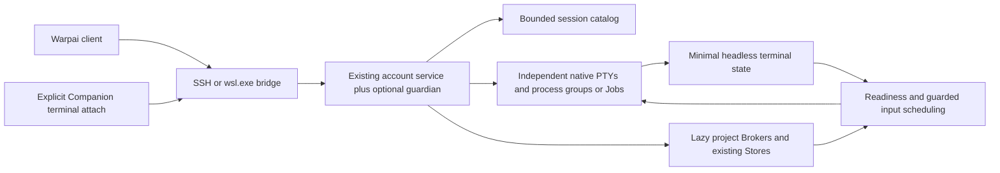

# Optional SSH/WSL guardian implementation design

Status: R4 proposed design. Preserve local runtime and unguarded paths. Use
[API.md](API.md) before coding; [HERDR.md](HERDR.md) records reference choices.

## Ownership and topology

One guardian per verified execution OS account hosts all guarded sessions/projects,
independent of Agent type and client. Use an account-global private endpoint and
startup election shared by compatible SSH/WSL helpers when they prove the same
OS user. Distinct distro/kernel/users remain separate. Preserve logical SSH/WSL
MCP namespaces, adapter capabilities and Store ownership without auto-merging them.
Existing non-guardian service paths remain unchanged. No per-task/type daemon,
remote renderer, native-local daemon or local Broker move. See [CLI.md](CLI.md).

Resolve the guardian root from the effective UID's OS account home, not
`HOME`/`XDG` or route variables: `<passwd-home>/.local/share/warpai/guardian`
on Linux, `<passwd-home>/Library/Application Support/warpai/guardian` on macOS.
One `service.lock` guards DB open, cleanup and listener bind across versions; the
stable `service.id` and `catalog.sqlite3` live beside it. A private
`/tmp/warpai-guardian-<euid>/` (0700) holds `ssh.sock` and, on Linux, `wsl.sock`
(0600). A candidate probes a responsive owner before spawning and may remove only
an owned stale socket inode while holding the lock. The bounded IPC preface
exchanges guardian IPC major, requested route, guardian ID and non-nil boot UUID;
both ends verify peer UID and the handshake. Lock files or PID files are not
liveness proof, and an incompatible or unauthorized owner is never replaced.

Ensure the daemon when guardian is explicitly enabled. Keep a compatible live
instance across reconnects; a helper lacking a required logical-scope capability
fails explicitly rather than creating a second guardian. Bound per-scope adapter
resources inside the shared process and count all of them in overhead measurements.

Each managed session has immutable launch-time policy `connection_owned` or
`guarded`. The legacy policy retains exact disconnect/release behavior. Guarded
policy ties PTY/RunBinding/reader/native state to the service's native run, not the
client connection. A mixed service can host both; disconnect affects each by its
own policy. Profile defaults never mutate live ownership.

## Current source and proposed changes

| Existing location | Planned focused change |
| --- | --- |
| `crates/remote_protocol/proto/remote_server.proto` | Add explicit guarded launch/discovery/attach/control/capability contract |
| `crates/remote_protocol/src/managed.rs` | Validate guard policy, attachment, snapshot and scoped catalog bounds |
| `crates/agent_bus/src/companion.rs` | Negotiate/dispatch SSH or guest capabilities with existing account/project fences |
| `crates/agent_bus/src/companion_service.rs` | Reuse detached service; shared wake/deadline scheduling, retention and idle exit |
| `crates/agent_bus/src/companion_terminals.rs` | Separate session policy from attachment; preserve guarded run after disconnect |
| `crates/agent_bus/src/companion_tasks.rs` | Keep guarded RunBinding alive; reuse existing Broker/task engine |
| `crates/agent_bus/src/companion_guests.rs` | Review WSL guest-native discovery separately from service-owned managed sessions |
| `crates/agent_bus/src/native_pty_unix.rs` | Host-owned process-group lifetime and verified descendant stop |
| `crates/agent_bus/src/native_pty_windows.rs` | Remote-host ConPTY/Job ownership independent of SSH launcher |
| `crates/agent_bus/src/screen_detection/native.rs` | Reuse minimal screen state; export/import assessment without duplicate parser |
| `crates/agent_bus/src/transport.rs` | Event-triggered Broker wakes, exact-run guards and existing task serialization |
| `crates/agent_bus/src/companion_main.rs` | Explicit guarded launch/list/attach/detach CLI; keep legacy EOF behavior |
| `crates/agent_bus/src/wsl_companion_main.rs` | Guest build entry uses the same retained-session semantics in WSL namespace |
| `app/src/agent_communication/panel.rs` | Optional remote launch choice and authoritative remote session projection |
| `app/src/agent_communication/ssh_settings.rs` | Scope guardian preference to verified SSH target; future launches only |
| `app/src/agent_communication/wsl_settings.rs` | Scope preference/selection to verified distro/user; preserve WSL opt-out |
| `app/src/terminal/cli_agent_sessions/mod.rs` | Remote guarded run identity independent of transient view EntityId |
| `script/companion/package.py` | Source-matched remote payload and side-by-side compatible runtime updates |
| `script/companion/package-wsl.py` | Source-matched Linux guest payload; preserve namespace and bundled provenance |

Enumerate callers, feature gates, constructors, fixtures and shutdown paths before
each edit. Local terminal-manager Drop, local Broker hosting, local MCP scope and
ordinary native shell launch are regression surfaces, not migration targets.

## Enabling and launching

1. Check the existing SSH/WSL integration switch and confirmed execution identity.
   Guardian cannot bypass either or start unrelated hosts/distro accounts.
2. Probe the installed Companion/guest capability. Connect to an existing service
   before spawning; use startup locking and private IPC. Never unlink a live
   endpoint due only to timeout or start a second Store owner.
3. Resolve session policy from explicit launch choice and future-launch profile
   default. Only the new guarded operation may retain the run. The old launch path
   remains connection-owned with identical behavior.
4. Reuse validated original vendor executable/args/cwd/auth and current MCP adapters.
   Managed shell/command sessions can have no Agent binding. Do not wrap all SSH
   logins, vendor commands, aliases or native WSL shells automatically.
5. Save minimal policy/identity metadata, launch the native group/Job, create the
   exact run binding, then return the attachment. Launch uncertainty reconciles
   by request/session ID instead of starting another process.

## WSL-specific ownership boundary

The packaged installer creates account-owned component directories under a
private umask and removes legacy group/other write bits on those directories.
An existing shared parent configuration directory is rejected without changing
its permissions. This keeps SSH-first verification consistent with the
installed guest executable, manifest and directory trust checks.

Current WSL native MCP discovery observes foreground Linux processes; that alone
is not a retained PTY owner. Keep it unchanged for unguarded sessions. A guarded
launch must enter an explicitly service-owned guest PTY, reuse native vendor MCP
configuration and associate the confirmed Linux process group/birth identity with
that run. Never inject Windows MCP environment or adopt arbitrary background PIDs.

Use the dedicated `warpai-wsl-companion` payload/namespace and literal `wsl.exe`
distribution/user/exec arguments. Terminating the Windows bridge or desktop must
not own/kill the Linux guardian. Verify the guest remains running on supported WSL
versions after all client bridges exit; use only the minimum necessary guest-side
keepalive if measurements prove it required. No busy loop or unrelated distro
startup. `wsl --terminate`, `wsl --shutdown`, Windows shutdown and guest service
crash remain host/runtime-loss boundaries, with unknown attempts reconciled.

Nested SSH routes use the confirmed final SSH execution host; do not mark the WSL
outer shell as the owner of a nested remote Agent. Two distro users/projects and
SSH/WSL namespaces cannot share identity through labels or filesystem path strings.

## Headless feature responsibilities

Keep native PTY output draining, process lifecycle, Agent MCP, existing task Store,
Broker message/results/attention facts, readiness and guarded peer delivery alive.
Only keep project Brokers with live guarded runs or active client requests; close
idle handles/caches under existing data safety rules and recreate lazily.
Guarded project handles are leased by every live run and in-flight request,
including forwarded Worktree bindings. A parked project may close its idle
listener and database without deleting its Store; reopening preserves the
original root binding and durable task state. Use idle projects as the first
capacity recovery path. The async guardian accept loop does not join Brokers.

Native wake selection reads only inbox routing metadata through the recipient
index and stops at the first eligible notice. The Agent's inbox and cooperative
wait still return full messages. Apply the same stale-task and active-run gates
when selecting or claiming a notice, without changing acknowledgement state.

Do not host a hidden desktop. No GPU/UI rendering, full-window framebuffer,
usage-dashboard polling, recursive workspace indexing or permanent file watchers.
SFTP connections and WSL transfers remain client/request-owned. Release transfer
resources and temporary staging safely on disconnect; preserve uncertain mutation
receipts instead of replaying writes on reconnect. UI/Review/editor reconnect to
remote facts on demand; unsaved drafts retain existing client ownership.

The desktop editor reserves the baseline hash and the intended hash of a file
commit before sending it. The local remote-editor receipt contains only those
hashes and is keyed by the confirmed account, logical service, project and
remote document identity. A fresh, independently verified attachment for the
same document can recover it after a desktop restart. Draft text and file
contents retain their existing client policy. Reconnect verifies the original account/project through
the existing attachment fence, then checks the remote hash with a read-only
request. A matching intended hash confirms the observed content, a matching
baseline permits an explicit save, and another hash preserves the draft and
requires an explicit reload or conflict decision. Background saves are suspended
while the receipt is unresolved or awaiting explicit save. Receipt IO failure
prevents sending a new write. Hold a bounded local lock across each write and
its receipt transition. The recovered receipt never stores connection
arguments, credentials, drafts or staged content, and reconnect never
resubmits an interrupted mutation.

Persist remote editor tab paths and the confirmed workspace fingerprint through
the existing desktop pane snapshot. Cache paths and transport arguments are
transient. A restored pane keeps remote tabs dormant until focused and a matching
remote workspace is verified. Local tabs can restore immediately in the same
pane. A lookup must not send a file request to a mismatched account or project.
Restore downloads on demand and bind them to the confirmed remote source so a
restored tab cannot save a remote path on the desktop filesystem.

Guarded Coordinator rights survive only for the proven same native run. Reconnect
or focus grants no new task/checkout authority and accepts/integrates no result.
Permission waits remain blocked. Changes to existing task/MCP acknowledgement,
revision-aware handoff and review semantics are explicitly out of scope.

## Low CPU and memory implementation

The current Companion wake worker sleeps 300 ms per Agent and scans Broker wakes.
Retaining many sessions with this loop would multiply idle work. Replace polling
for the guarded path with shared notifications and nearest-deadline scheduling:

Guarded native delivery runs on the existing Tokio runtime. A Broker watch
coalesces Store changes. Each run signals its own input and committed PTY
output so unrelated redraws leave sibling workers asleep.
Ordinary peer notifications resolve through the terminal's indexed Broker
binding. Broadcast pool notices still use the existing project-wide winner
selection and claim validation. A delivered pool notice reserves its wake even
when earlier unread mail remains ahead of it in the recipient's inbox.
The worker uses the existing quiet/ready gates as deadlines and spaces
draft cancellation, paste and Enter by at least 300 ms. A periodic safety
check handles external Stores and checks that the native run still exists.
The connection-owned worker keeps its current timing.

- PTY bytes update the terminal parser once and mark that session dirty. Coalesce
  redraw bursts before readiness sampling; never skip required idle/submit timing.
- Bound each OSC record passed to the readiness parser before it accumulates the
  payload. Oversized records leave readiness signals unchanged and do not alter
  the live PTY stream or its retained bytes.
- Broker changes notify the relevant session through the existing task engine.
  Index pending delivery by terminal/run; do not scan every project on every tick.
- A shared deadline queue covers quiet windows, paste/Enter delays, process reaping,
  retention expiry and fallback observation. Sleep until IO, an event or the nearest
  real deadline. A lost notification must not lose work; recheck state under the
  same queue synchronization and use a low-frequency safety reconciliation.
- Use existing shared async runtime and bounded blocking IO where native APIs
  require it. Do not add one Tokio runtime, polling worker or timer per task.
  Inventory retained reader/writer threads and stack costs before changing them;
  move to shared IO only where measured savings justify the native complexity.
- Keep one minimal terminal state per PTY, reusing readiness state. Allocate output
  rings as needed. Serialize snapshots only during attach/resync, allow one in
  flight per session and bound concurrent account-level serializers.
- Do not preallocate maximum history for every session, copy full screens for
  every poll, parse each output twice, or recompute panel/task projections when
  nothing changed. Status listing reads bounded cached facts with evidence age.

Proposed acceptance targets on a documented quiet 2-vCPU reference VM, excluding
vendor CLI/tests/servers but including guardian threads/parser/Brokers/queues:
base guardian RSS at most 32 MiB, incremental idle 120x40 session memory at most
2 MiB, and idle 8-session average CPU at most 0.2% of one core over 60 seconds.
Use CPU-time deltas, repeat runs and report host noise. These are design targets,
not claims that Rust/SQLite/OS behavior already meets them. S8 must measure,
optimize or explicitly revise with evidence before release; no silent target waiver.

Use an isolated native registry fixture to measure process RSS, CPU time,
context switches and threads at 0, 1, 8 and 32 guarded sessions. Its separate
mixed-load case uses two project roots, a continuous output producer, a blocked
input pipe and a quiet command, then checks the quiet command's round trip and
observed stops. The local fixture measures the guardian-side component without
claiming the release VM, real Agent Broker and mixed-version matrix.

Preserve the current maximum 32 sessions as an admission ceiling, not a resource
reservation. Start with lazy 256 KiB output ring/session, 32 KiB wire pages,
2 MiB transient serialized snapshot ceiling and 64 MiB account terminal-data cap.
Count live parser buffers, scrollback, snapshots, queues and retained ended output.
Trim bounded history/expire snapshots before refusing new sessions; never kill
running work or discard task facts to meet a display budget. Overall RSS and
per-project Broker/cache overhead are separately measured and bounded. Initial
limits require S2/S8 proof with normal/larger viewports and split-screen workloads.

Guarded launch reserves bounded ring, input and readiness-grid storage before
starting the PTY. Use the actual cell width and charge both screens with room
for grid growth. Retain the dimension high-water charge across shrink because
the parser can keep vector capacity. New launches can evict only eligible ended
runs under pressure. A resize that exceeds the budget leaves the native size and
accepted resize sequence unchanged. The charge covers these buffers only and is
not a substitute for measuring total RSS, native IO or future snapshot storage.

## Multi-session and multi-task scheduling

Distinguish three layers: service hosts many projects; each project has many PTY
sessions; each Agent has its existing recipient/task queue. Parallel tasks use
independent Agent sessions. One Agent's tracked execution remains serial;
submission releases the execution slot while review remains pending as in 1.9.0.

Use per-session IO/input queues plus a shared fair ready queue. Round-robin only
ready sessions, with a proposed 64 KiB output-drain budget per turn and bounded
control work before checking deadlines. Do not serialize all PTYs behind one
slow client or hold service-wide locks during blocking writes, snapshot export,
Git/file operations or network sends. Separate stop/control from bulk output and
reserve dispatch capacity so floods cannot starve stop, permission attention or
quiet-session work. Record task IDs/revisions through existing Store operations;
no second durable task scheduler or automatic Agent spawning is introduced.

The Unix guardian bounds incomplete prefaces separately from established
channels. Local account operators have dedicated channel permits, so occupied
bridge channels cannot consume the capacity for a local catalog/stop operation.
Long-running local CLI attachments use regular bridge permits. Preface
acceptance still requires the same private socket and peer identity.
Lifecycle scans skip busy run/output locks and retry on the next maintenance
tick. A busy run remains retained and cannot be evicted to admit another run.
Channel EOF and write errors also move native cleanup to the blocking executor.
A slow PTY may hold its own cleanup, while other admitted channels continue using
the shared async dispatcher.

Session launch/attach concurrency is bounded, failed attempts release reservations,
and stop-one cannot affect sibling sessions. Bare CLI stop and explicit stop-all capture all current-account guarded runs
without a selector/confirmation, then return per-run receipts; partial failures
remain visible. An explicit project filter narrows the captured target set.
Reconnect lists sessions/tasks/attention first, then snapshots only selected PTYs.
Different projects retain admission and worktree isolation even under shared load.

## Terminal restoration, storage and idle exit

Freeze the smallest native state sufficient for terminal modes, cursor, active/alt
buffers, bounded history and required shell/block boundaries. Reuse current native
terminal facilities; headless detection alone does not prove block fidelity.
Export a versioned snapshot at output offset N and import it without repeating OSC
side effects. Continue from N with ordered tail, parser-safe split-sequence state,
resize revisions, digest and explicit resnapshot on output gaps. Plain CLI attach
may consume an ANSI projection of the same host state without resetting native
Warpai block metadata or taking a second resize owner.

### Current snapshot boundaries

| Live state | Existing owner | Representation gap |
| --- | --- | --- |
| Absolute output offsets and bounded ring | `companion_terminals::Output` | The ring can discard earlier prompt, saved-screen and escape state. It cannot establish the state at a cut. |
| Native readiness screen | `screen_detection::native::NativeScreen` wraps `vt100::Parser` | Formatted screen output cannot export private decoder state or both primary and alternate buffers. The readiness screen uses zero scrollback. |
| Desktop cursor, cells, history and rendering modes | `GridHandler`, `GridStorage`, `FlatStorage` and the terminal model's alternate screen | Existing `GridStorage` serialization skips its cursor, saved cursor and trim count. `GridHandler` separately owns history, active hyperlinks and ANSI state. |
| Partial terminal input and shell lifecycle | `ansi::Processor` wraps `VteParser` plus DCS/APC and synchronized output state; `TerminalModel` owns the active block | The parser and wrapper need matching portable state, or a bounded suffix from a proven safe cut. Completed `SerializedBlock` data is line-trimmed and omits active shell/parser state. |
| Host effects | `ansi::Processor::osc_dispatch` and its `Handler` | Import must restore data through a state-only target. Clipboard, notifications, terminal replies and shell actions remain enabled only for live bytes after the cut. |

S2 first needs a lossless round trip for the portable parser and display state.
Run the same suffix through uninterrupted and restored state at every byte cut
in split UTF-8, CSI and OSC fixtures, then compare both screens and observe that
the state-only import emits no effects. Guarded parsing records the bundled
shell's encoded DCS/OSC and Bash key-value lifecycle hooks in a bounded
projection. Prompt, native input buffer, command identity, command range, and
exit status travel with the screen in a single checkpoint. DCS and unfinished
key-value data survive a split cut. Only primary-screen row anchors are assigned
to shell commands. Trimmed rows and blocks report their missing history without
inventing output. Keep shell text in memory and outside the catalog.

Add desktop static import before exposing the guarded data bridge to desktop
writers.

The readiness parser will use source-matched local copies of its pinned VT100
and VTE dependencies for access to private checkpoint state. Keep their license
and provenance alongside the source. The desktop's existing Warp VTE fork
remains independent. Add narrow APIs to capture state and validate it before
import. A representation derived solely from rendered ANSI cannot recover the
inactive buffer, saved state or unconsumed bytes at the cut.

Keep output/screens/drafts in memory only. Persist minimal nonsecret catalog IDs,
policy, target/project references, timestamps and proven lifecycle evidence in
namespaced tables using existing SQLite facilities. Never store argv/environment,
MCP bearer tokens or relaunch plans. On runtime restart, prior live runs become
interruption/unknown evidence until explicit guarded reconciliation; no auto-resume.

Durable catalog storage is a separate `guardian/catalog.sqlite3` opened only under
the guardian lock, with `application_id=0x57474341` and `user_version=1`.
`guardian_catalog_sessions` is keyed by session UUID and stores exact run/boot
UUIDs, logical service/project IDs, actual policy and kind, bounded sanitized
label, creation/MRU sequences, state, observation Unix-ms and optional exit
status. A newly created file is initialized; an existing file is validated
read-only for schema/version and refused without overwrite when corrupt, unknown
or unversioned. Boot marks prior live rows interrupted/unknown in one transaction.
Durable rows are bounded; only resolved ended rows are pruned, and unresolved
uncertainty produces capacity failure. V1 has no migration or auto-recovery;
before any future migration, take and integrity-check a private consistent backup
under exclusive ownership, migrate in one transaction, and retain the backup for
explicit offline recovery. The in-memory boot-scoped catalog remains the index and
watch ring; durable metadata is required before external list/inspect/watch.

Retain ended output for a proposed 5 minutes, within the same memory cap and with
oldest-ended eviction under pressure. Keep durable task results and unresolved
execution facts independently. A guardian exits after the existing 60-second idle
window once there is no live guarded/legacy work, active request or retained output.
The bounded ended-output window may postpone idle exit; do not remain permanently
resident because an old catalog row exists. No auto-start/login service by default.

Pending native launches reserve their exact session ID and count against the
same account capacity as live PTYs. The registry lock is released before
native spawn, so a delayed launch cannot block input, reads or stop handling
for existing runs. Concurrent reuse of a pending ID reports a conflict.

The PTY reader advances the retained byte offset and the existing native Agent
screen under one output lock. Resize takes the same lock before the native
viewport change. This establishes a byte-cut barrier for the screen prototype
without holding parser state across a network request. Parser-state export,
shell/block restoration and the bounded paged snapshot format are separate
S2/S3 closure requirements.

Guardian maintenance uses an independent deadline. Continuous incoming
connections cannot postpone pending route admission, the catalog or exit
reconciliation. The service skips overdue ticks instead of accumulating them.

When the verified Linux execution account is a WSL guest with an installed
WSL Companion, SSH-first election selects the manifest-verified dual-route
guest image. The same image starts on a WSL-first request. The helper's private
ABI probe confirms support for both routes before startup. Shared ownership
does not change logical Store or setup authority: each admitted route owns its
own Projects adapter and native MCP settings. An existing one-route owner
keeps its live work until normal shutdown.

## Future-launch preferences

Store SSH opt-ins by the verified logical service ID of the selected account,
and WSL opt-ins by the selected distribution and user. An old development
boolean is never applied to an unrelated account. Opt-in changes future
launch intent. The collaboration panel continues to use the ordinary managed
transport, which can follow a verified same-scope guardian owner without
turning a normal project read into a guarded launch.

## Platform and compatibility gates

SSH Unix hosts need independence from launching TTY/SIGHUP and host login-session
cleanup policy. Remote Windows needs correct ConPTY/Job ownership and independence
from the SSH launcher Job; detached flags alone do not prove this. Fail guarded
launch clearly if safe native ownership is unsupported. WSL guest lifetime needs
real Windows/WSL acceptance, not Linux SSH proxy tests.

On Windows, the SSH account guardian shares the existing SSH Store lock with the
ordinary Companion service. A distinct private named pipe negotiates the same
guardian preface and fences as Unix. Both peers verify the pipe peer's native
account SID. Start the guardian suspended, request job breakaway when the
launcher is job-bound, and require zero inherited Job memberships before
resuming. Each guarded ConPTY still owns its own kill-on-close Job. Operator
current-session detection requires membership of that exact Job. Native tests
must cover blocked breakaway, same-process reconnect, and legacy fallback.

Reuse compatible live runtime versions. Stage helper/dependencies side by side
when an update would invalidate files used by live runs; GC only unused versions.
No new local helper installation, AppImage-local daemon survival or local Broker
cutover work is needed. Preserve existing Windows-bundled WSL guest provenance.

S0 freezes API/policy, unified account ownership and logical namespaces; S2 freezes terminal representation;
S5 freezes WSL lifecycle/native admission; S7/S8 freeze fairness/resource limits
from measurements. Detailed chosen/rejected methods and evidence go in the ledger.

## Private CLI and automatic client restoration

Reuse existing Companion/guest binaries with a `ctl` dispatcher. The interactive
`warpai` spelling is a session-only function in supported Warpai remote shells,
forwarding argv to the verified absolute executable path. No shell-rc/profile,
PATH or user command override. Independent SSH/WSL shells use the absolute path.
See CLI for argument/default/name/collision rules and native TTY cleanup.

Reconnect automatically fetches account-scoped bounded catalog metadata and
admitted project/task/status projections; change watches are shared per connection
and cursor-fenced. Restore a prior writer only when free and exact-run-valid.
Generate full terminal snapshots lazily; a writer conflict is visible and needs
explicit takeover. No vendor relaunch, implicit task acknowledgement or account
wildcard stop is part of information restoration.

## Minimal core command implementation

Maintain daemon-serialized MRU activity sequence on foreground attachment/selection;
list, background refresh and task observation do not change it. Bare resume uses
current/unique/MRU live target with deterministic fallback, refusing writer theft.
Bare stop immediately captures current-account guarded runs into a bounded,
daemon-owned batch that continues if the caller's PTY/socket closes. Retain exact
per-run receipts; idle shutdown is separate from native run termination.

Only list/resume/stop and installed help/version are public CLI scope. List combines
cached availability/state with session metadata, using existing catalog and no
snapshot/observer worker. Creation/naming stay in Warpai UI; detach uses client
closure or a CLI-local escape; guardian ensure/idle exit stay automatic. Do not
build separate read/wait/rename/remove/admin APIs, completion generators, aliases
or a second task/terminal management surface for withdrawn proposals. Preserve
required internal snapshots, notifications, project APIs and cleanup guards.
